Any fenced code block with the `mermaid` language becomes a diagram. These
examples show the most common diagram types. See
[Basic Usage](/docs/guides/basic-usage#mermaid-diagrams) for how the rendering works.

## Flowchart

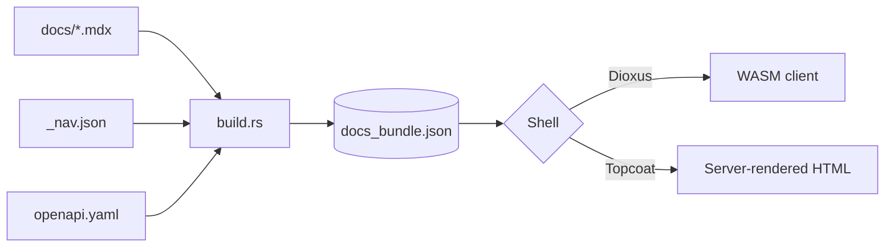

## Sequence Diagram

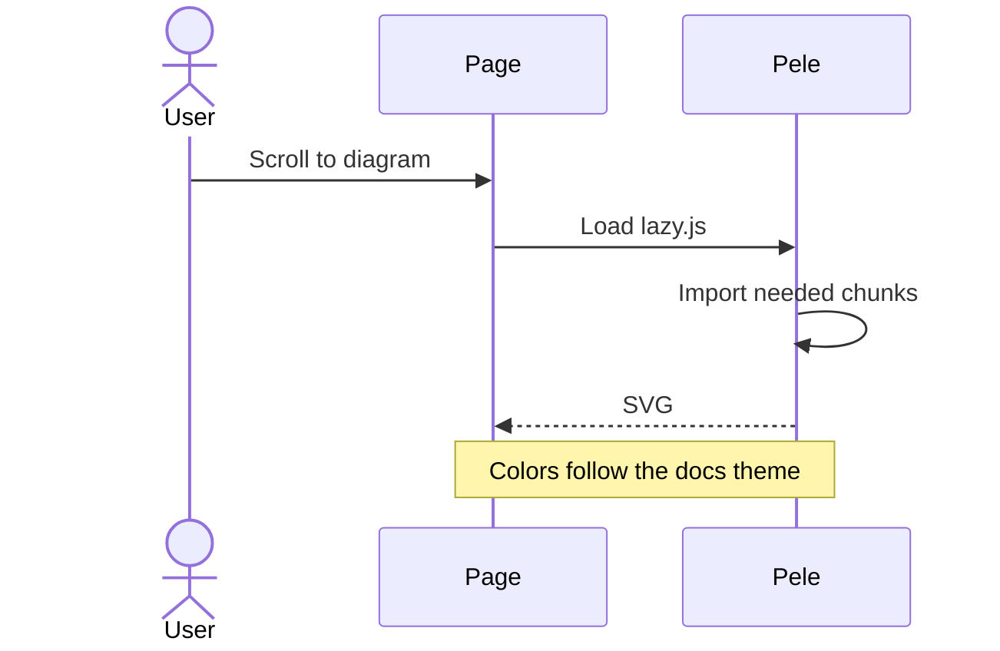

## Class Diagram

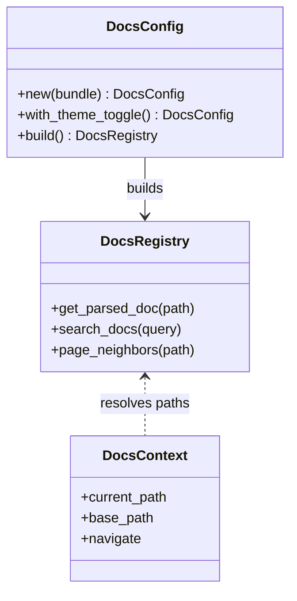

## State Diagram

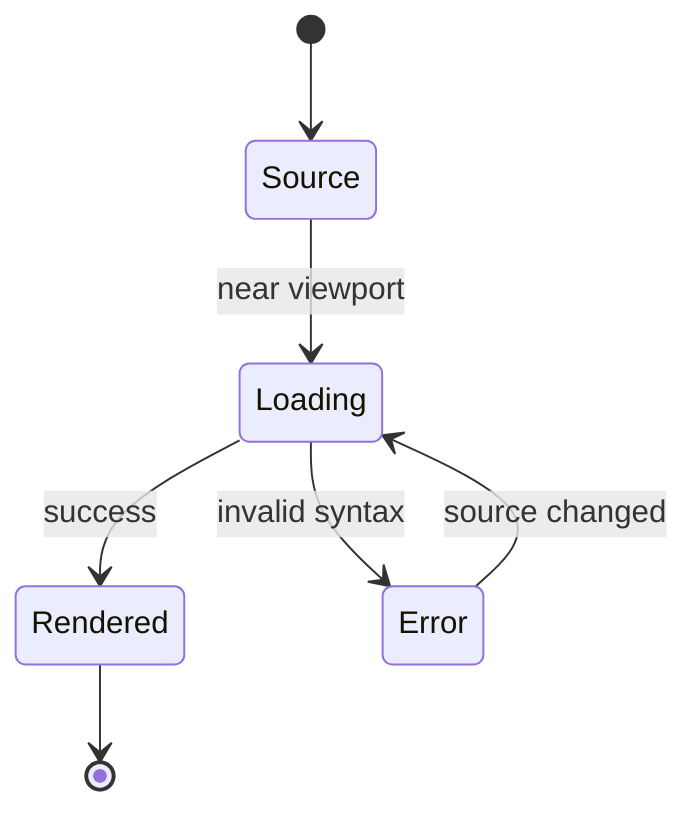

## Entity Relationship Diagram

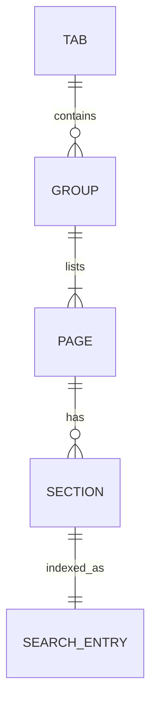

## Gantt Chart

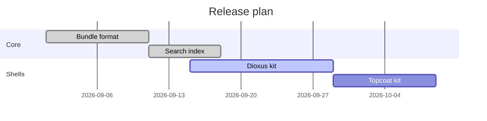

## Pie Chart

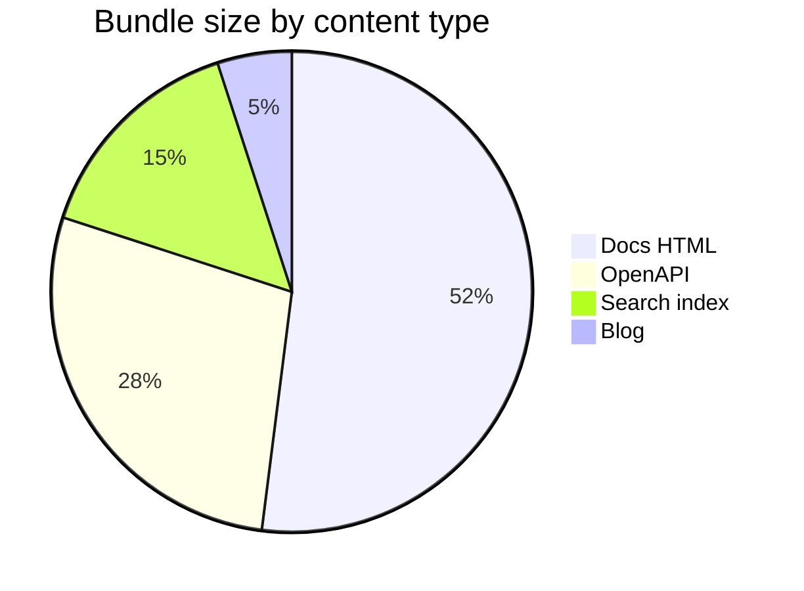

## Git Graph

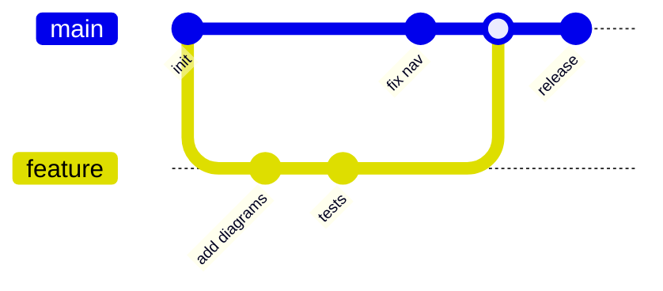

## Mindmap

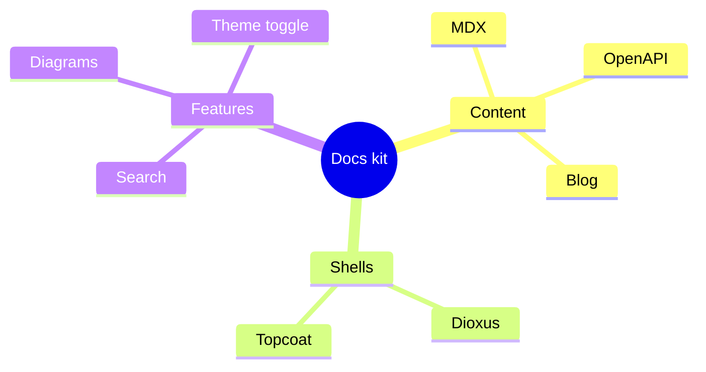

## Timeline

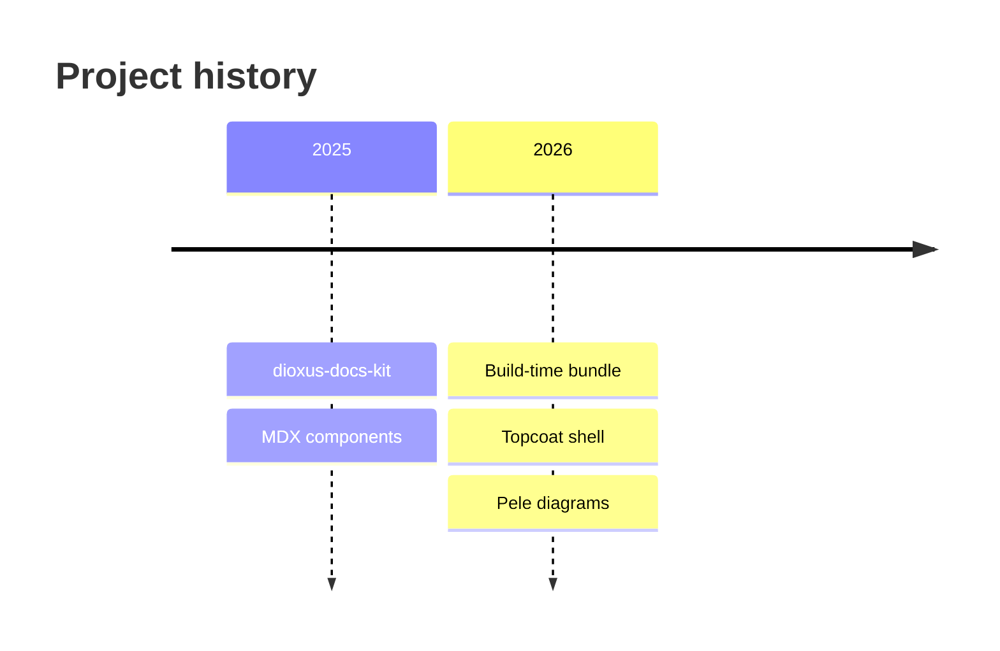

## XY Chart

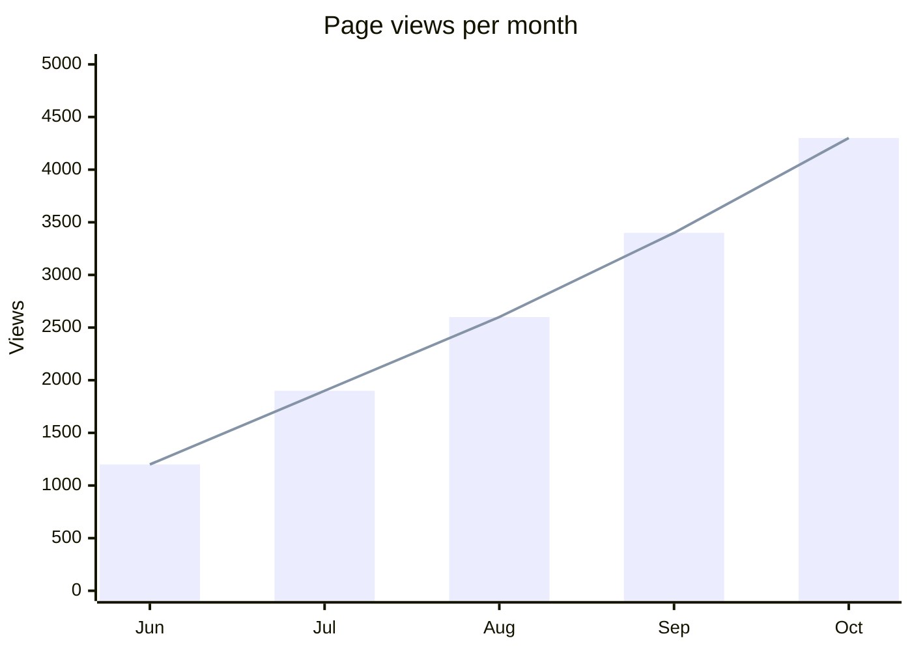
